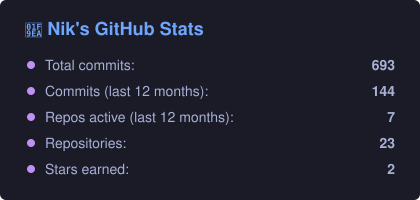
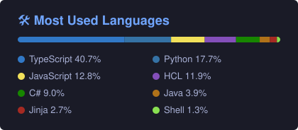

<div align="center">


📍 Ottawa, ON &nbsp;·&nbsp; 🌐 [pcenicni.dev](https://www.pcenicni.dev/) &nbsp;·&nbsp; 📫 nik@pcenicni.dev

[](https://www.linkedin.com/in/nikholaspcenicni/)
[](https://www.pcenicni.dev/)


</div>

---

### 🧑🏻‍💻 `whoami`

```javascript
const nik = {
  pronouns: ["he", "him"],
  location: "Ottawa, ON 🇨🇦",
  dayJob: "Senior Developer",
  nightJob: "Unpaid SRE for a household of exactly one cluster",
  homelab: {
    nodes: ["helium", "neon", "argon"],        // noble gases, because the servers are inert... mostly
    comingSoon: ["krypton", "xenon", "radon"],  // radon: definitely not a radioactive idea 🫠
    stack: ["Proxmox", "Talos", "Kubernetes", "ArgoCD", "Terraform", "Ansible"],
  },
  alsoTinkersWith: ["ESP32s", "3D printers", "Tesla browsers", "MagicMirrors"],
  uptimeSLA: "99.9% (the 0.1% is when I touch something)",
  ask: () => "me about self-hosting, I will not stop talking",
};
```

### 🧪 Things I'm building

| | Project | What it does |
|---|---|---|
| 🎬 | [**Nikflix**](https://github.com/nikpcenicni/Nikflix) | My whole homelab as code — Talos + Kubernetes on Proxmox, wired up with Terraform, Ansible and ArgoCD, with a self-hosted media stack on top. GitOps all the way down. |
| ⚖️ | [**SpoolmanScale**](https://github.com/nikpcenicni/SpoolmanScale) | An ESP32 filament scale with an NFC reader and a touchscreen. Plop a spool on it, it knows what it is and how much is left. *One scale to rule them all.* |
| 🚗 | [**DashPlay**](https://github.com/nikpcenicni/DashPlay) | Fullscreen playback from custom media sources in the Tesla browser. Because the car should be a cinema when parked. |
| 🩺 | [**jellyfin-restart**](https://github.com/nikpcenicni/jellyfin-restart) | A macOS watchdog that notices when Jellyfin stops responding and turns it off and on again, so I don't have to. |
| 🌩️ | [**cf-ddns**](https://github.com/nikpcenicni/cf-ddns) | Cloudflare dynamic DNS in a shell script. My ISP changes my IP; I change nothing. |
| 🪞 | [**MMM-iCloud-Client**](https://github.com/nikpcenicni/MMM-iCloud-Client) | MagicMirror² module that turns iCloud contacts into a birthday calendar. The mirror remembers so I don't have to. |

<sub>…plus a handful of 🔒 private side quests in progress. Including at least one murder mystery. 🕵️</sub>

### 🛠️ Toolbox

<p>
  <br/>
  
</p>

### 🪦 The Repo Graveyard

> *Here lie the projects of yesteryear. They compiled once. That's all we can ask.*

- 🧱 [**tetris**](https://github.com/nikpcenicni/tetris) — the rite of passage
- 📺 [**Netflix**](https://github.com/nikpcenicni/Netflix) — a clone, long before the homelab made it real (see: Nikflix)
- 🚀 [**FinalFrontier**](https://github.com/nikpcenicni/FinalFrontier) — C# in space
- 🧠 [**nachos**](https://github.com/nikpcenicni/nachos) — building an OS in Java, as one does in school
- 🐦 [**Twitter-Dataminer**](https://github.com/nikpcenicni/Twitter-Dataminer) — from when it was still called Twitter
- 🎭 [**Dhar-Mann-TikTok-Bot**](https://github.com/nikpcenicni/Dhar-Mann-TikTok-Bot) — no further questions
- 💳 [**npx-card**](https://github.com/nikpcenicni/npx-card) — business card, but make it a terminal command

### 📊 Stats

<div align="center">




<sub>Counted across public + private repos, regenerated daily.</sub>

</div>

### ⏱️ Where my week went

<!--START_SECTION:waka-->
<!--END_SECTION:waka-->

---

<div align="center">

<sub>⚡ Fun fact: if it can be self-hosted, it probably already is on my network.</sub>

</div>
